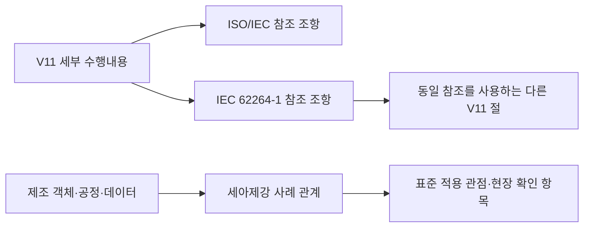

# Manufacturing AI · Standards Mapping & Ontology

**제조 AI 생명주기 지침의 세부 수행내용과 참조표준, 제조 객체 관계를 탐색하는 지식 구조화 프로젝트**

[대시보드 소스](./index.html) · [V11 내부 공통참조 관계](./V11_내부_공통참조_관계.csv) · [세부 참조 매핑](./V11_세부_참조_매핑.csv) · [아키텍처 시각화](./docs/repo-architecture.svg)

## 1. 프로젝트 개요

제조 AI 시스템의 설계·개발·배포와 관련된 V11 세부 수행내용을 ISO/IEC 및 IEC 참조 조항과 연결하고, 동일한 참조 근거를 사용하는 다른 V11 절을 함께 탐색할 수 있도록 구성한 대시보드입니다.

표준 조항을 단순 나열하는 대신 **세부 수행내용 → 참조 근거 → 내부 공통참조 관계 → 제조 현장 사례**를 하나의 탐색 흐름으로 보여주는 데 목적이 있습니다.

## 2. 주요 기능

| 영역 | 구현 내용 |
|---|---|
| 세부 표준 매핑 | V11 세부 수행내용과 ISO/IEC 참조 조항 연결 |
| 내부 관련 절 탐색 | 동일한 IEC 62264-1 참조 절을 공유하는 V11 절 간 관계 표시 |
| 그래프·표·계층형 보기 | 연결형 그래프, 매핑표, 순서도형, 계층형 보기 전환 |
| 관계 강조 | 세부 항목·참조 절·관련 V11 절 선택에 따른 연결 강조 |
| 세아제강 사례 | 공정값 X와 품질값 Y의 시각·위치 매칭, 공정 객체 관계 탐색 |
| SAREF4INMA | 제조 도메인 온톨로지 관련 참조 화면 |
| 시각화 방식 비교 | 관계를 표현하는 시각화 유형 비교 |

## 3. 지식 구조와 관계 흐름

## 4. 데이터 파일 구성

| 파일 | 역할 |
|---|---|
| `index.html` | 표준 매핑, 관계 그래프, 세아제강 사례, SAREF4INMA 등의 인터랙티브 화면 |
| `V11_세부_참조_매핑.csv` | V11 세부 내용과 참조 조항 간 매핑 |
| `V11_내부_공통참조_관계.csv` | IEC 62264-1 공통 참조를 공유하는 V11 절 간 관계 |
| `seah_33_clauses.csv` | 세아제강 제조 사례를 V11 절 관점으로 정리한 데이터 |
| `graph-data.json` | KS V11 참조 온톨로지 그래프 데이터 |
| `mapping_data.json`, `data.json` | 매핑·세부 수행내용을 표현하는 구조화 데이터 |
| `object_scenes.json` | 제조 객체 관계 시각화 장면 데이터 |
| `edge-explanations.csv`, `reference_cases.csv` | 관계 설명 및 참조 사례 데이터 |
| `V11_Field_Checklist*.xlsx`, `field_checklist.csv` | 현장 점검용 체크리스트 자료 |

## 5. 관계 해석의 중요한 제한

이 프로젝트에서 가장 중요한 부분은 그래프의 연결선을 과도하게 해석하지 않는 것입니다.

- **동일 참조 공유:** 내부 관련 절은 동일한 IEC 62264-1 참조 절을 사용하는 관계를 나타냅니다.
- **직접 인용 아님:** 두 V11 절이 서로를 직접 인용하거나 상호 의무를 부과한다는 뜻이 아닙니다.
- **선후관계 아님:** 자동으로 연결된 엣지는 필수 선행·후행 프로세스를 의미하지 않습니다.
- **매핑 근거 수준 차이:** 기존 README는 일부 핵심 절의 설명이 원문 세부 내용에 기초한 초안이며, 나머지는 참조 이유 기반의 잠정 매핑이라고 밝힙니다.
- **표준 적합성 판정 아님:** 실제 적합성·준수 판단에 사용하기 전 V11 원문과 해당 표준 원문을 검토해야 합니다.

## 6. 세아제강 사례에서 다루는 제조 맥락

저장소의 사례 데이터는 도금 공정과 검사 품질 데이터 사이의 연결 문제를 표준 관점으로 구조화합니다.

- 공정값 X와 품질값 Y의 생산 대상 식별
- 공정 발생 시각과 검사 시각의 차이
- 파이프 위치·측정 위치 정보의 연결
- AI 입력 데이터의 유효 범위와 데이터 인수 조건
- 품질 측정 범위 및 현장 증빙의 필요성

특히 사례 CSV는 수행·운영 실적이 확인되지 않은 항목을 별도 상태로 표시합니다. 따라서 적용 제안과 실제 수행 완료를 동일하게 취급하지 않습니다.

## 7. 기술 구성 및 실행

- Frontend: HTML, CSS, JavaScript
- Data: CSV, JSON
- Visualization: SVG 기반 관계 그래프 및 인터랙티브 매핑 화면

저장소의 `index.html`을 브라우저에서 열어 확인할 수 있습니다. 대시보드는 정적 파일과 저장소 내 데이터 파일을 중심으로 구성되어 있습니다.

## 8. 확장 방향

1. 표준 조항과 세부 수행내용에 출처·버전·검토 상태 메타데이터를 부여합니다.
2. 공통 참조, 직접 인용, 인과, 선후행, 데이터 흐름 등 관계 유형을 분리합니다.
3. 제조 객체(설비·공정·제품·데이터·AI 모델)와 표준 요구사항을 연결합니다.
4. 현장 증빙 및 검증 결과를 관계 노드에 연결해 표준 매핑의 추적성을 높입니다.

---

Portfolio note · 공통 참조 관계, 해석적 매핑, 적용 제안, 확인된 현장 사례를 구분합니다.
